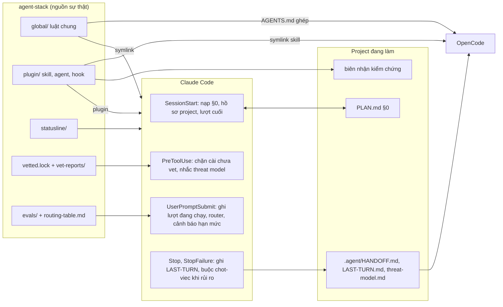

# agent-stack

Bộ công cụ cá nhân để làm việc lâu dài, an toàn và tiết kiệm hạn mức với **Claude Code** và **OpenCode**: một plugin Claude Code (9 skill, 5 subagent, 8 hook), statusline, bộ luật chung dùng cho cả hai công cụ, bộ eval để chọn model và effort, cùng quy trình kiểm duyệt mọi skill, plugin, MCP của bên thứ ba trước khi cài.

> **English summary.** agent-stack is a personal toolkit for Claude Code and OpenCode, written in Vietnamese. It ships a Claude Code plugin (9 skills, 5 subagents, 8 hooks) that keeps work state on disk so sessions survive usage limits, crashes and compaction; suggests the cheapest model, effort, subagent and skill per task; nudges the agent to back "done" with verified test receipts and risk-scaled review; and blocks known install commands for third-party skills, plugins or MCP servers until they pass a security vetting step pinned to a commit (a guard rail for the agent, not a security boundary). Everything is Python standard library only, hooks fail safe and never hang a session, and global activation goes through a reversible `install.sh` (dry run by default, full rollback). It is tuned for one person's machine (macOS, Vietnamese prompts), so treat it as a reference design rather than a drop-in product.

---

## Mục lục

1. [Vì sao có bộ này](#1-vì-sao-có-bộ-này)
2. [Cách các phần ăn khớp](#2-cách-các-phần-ăn-khớp)
3. [Thành phần](#3-thành-phần)
4. [Yêu cầu](#4-yêu-cầu)
5. [Cài đặt](#5-cài-đặt)
6. [Một ngày làm việc](#6-một-ngày-làm-việc)
7. [Dùng với OpenCode](#7-dùng-với-opencode)
8. [Nguyên tắc thiết kế](#8-nguyên-tắc-thiết-kế)
9. [Cấu trúc repo](#9-cấu-trúc-repo)
10. [Phát triển và kiểm tra](#10-phát-triển-và-kiểm-tra)
11. [Bảo mật và giới hạn](#11-bảo-mật-và-giới-hạn)
12. [Tài liệu khác](#12-tài-liệu-khác)
13. [Giấy phép](#13-giấy-phép)

---

## 1. Vì sao có bộ này

Làm việc nhiều ngày với agent lập trình hay vấp bốn chuyện:

| Vấn đề | Cách agent-stack xử lý |
|---|---|
| **Mất tiến độ** khi hết hạn mức, crash, compact hay đổi công cụ | Trạng thái nằm trên đĩa: mục §0 "Đang ở đâu, việc tiếp theo" của `PLAN.md`, `.agent/HANDOFF.md`, `.agent/LAST-TURN.md`. Hook tự nạp lại khi mở phiên và tự ghi lúc gửi tin (đang chạy), khi xong lượt và khi lỗi API kết thúc lượt, kể cả ở thư mục không phải project. |
| **Không biết làm gì tiếp** khi quay lại project sau vài ngày | Skill `tien-do` đọc §0, git, TODO rồi xếp việc theo 5 bậc ưu tiên; cây kế hoạch bấm chọn được. |
| **Tốn hạn mức** vì chọn model quá mạnh, hoặc làm hỏng việc vì chọn quá yếu | Router gợi ý model, effort, subagent, skill cho từng tin nhắn, dựa trên hồ sơ project và số liệu eval của chính người dùng. Đổi model giữa phiên làm mất prompt cache, nên router đọc số liệu phiên (của mod giao diện, không có thì transcript) và chỉ gợi ý `/model` khi rẻ; lúc khác gợi ý giữ model và giao subagent. Cuối mỗi câu trả lời có dòng `➡️`. |
| **Cài đồ bên thứ ba thiếu kiểm tra** | Skill `vet-skill` ghim commit, quét dấu hiệu độc hại, ghi kết quả vào `vetted.lock`. Hook chặn các lệnh cài quen thuộc khi đích chưa được duyệt. |

Thêm vào đó là các cổng chất lượng: không được nói "xong" khi chưa có biên nhận kiểm chứng, threat model ngắn trước khi code chức năng đụng ranh giới tin cậy, review đối kháng theo mức rủi ro của diff.

## 2. Cách các phần ăn khớp



Mọi file ngoài repo (`~/.claude/CLAUDE.md`, skill của OpenCode...) chỉ là symlink hoặc bản chép do `install.sh` tạo, nên sửa trong repo là đủ.

## 3. Thành phần

### 3.1 Skill (`plugin/skills/`)

Skill tự kích hoạt theo từ khóa tiếng Việt hoặc tiếng Anh; gọi đích danh bằng `/agent-stack:<tên>`.

| Skill | Việc | Script chính |
|---|---|---|
| `session-keeper` | Lưu và khôi phục trạng thái: cập nhật §0, viết `HANDOFF.md` khi bàn giao, chạy bước kiểm sau khi bị ngắt. Ghi biên nhận kiểm chứng gắn với nội dung code lúc chạy, để phiên sau biết kết quả còn đúng hay code đã đổi. | `state.py`, `receipt.py` |
| `tien-do` | Tiến độ và việc nên làm tiếp (chặn đường, dang dở, giai đoạn hiện tại, nợ TODO, bị bỏ quên), kèm gợi ý model và câu `/goal`. `--all` cho mọi project. Vẽ cây kế hoạch dạng widget có ô tick. | `collect.py`, `plan_tree.py` |
| `task-router` | Gợi ý model, effort, subagent, skill cho một việc, tính cả hồ sơ project (ngôn ngữ, test, CI, code nhạy cảm) và việc tiếp theo trong §0. Tính chi phí ghi lại cache trước khi gợi ý đổi model. `merge_back.py` gộp nhánh worktree của subagent khi test đạt và fast-forward được, dừng khi đụng file nhạy cảm. `--session` cho công cụ không có hook như OpenCode. | `route.py`, `rules.json`, `merge_back.py` |
| `vet-skill` | Kiểm duyệt skill, plugin, MCP, marketplace của bên thứ ba: ghim commit, quét dấu hiệu độc hại (tải rồi chạy mã, đọc khóa, prompt injection, ký tự ẩn, hook tự chạy), chạy thử trong sandbox, chạy SkillSpector, kiểm lệch so với bản đã duyệt, ghi `vetted.lock`. | `vet.py`, `redflags.py`, `dynamic.py`, `drift.py`, `mcp_remote.py`, `spector.py` |
| `reuse-best` | Trước khi tự làm tool, tính năng, thuật toán: tìm thứ có sẵn tốt nhất theo thứ tự tính năng sẵn có, code trong project, skill đã duyệt, GitHub, bài nghiên cứu SOTA; kiểm từng tiêu chí bằng bằng chứng rồi quyết định dùng lại, điều chỉnh hay tự viết, và nêu phần còn phải làm. | `scout.py` |
| `chot-viec` | Cổng kiểm trước khi báo xong hay commit: nêu lại ý định, chấm rủi ro của diff (kể cả ranh giới tin cậy bị đụng), chạy kiểm chứng có biên nhận, tái hiện như người dùng sẽ dùng, review ở context mới với độ sâu theo rủi ro, rà tài liệu. | `risk.py` |
| `mo-hinh-de-doa` | Threat model ngắn cho một chức năng trước khi code, chỉ khi đụng ranh giới tin cậy. Tối đa 5 mối đe dọa kèm chốt chặn, ghi vào `.agent/threat-model.md` để reviewer kiểm lúc chốt việc. | – |
| `giong-van` | Chỉnh văn tiếng Việt hoặc tiếng Anh cho tự nhiên và đúng giọng người viết, bỏ dấu hiệu văn AI, không bịa thêm sự kiện. | `tells.py` |
| `goi-mcp` | Gọi MCP từ xa đã kiểm duyệt (DeepWiki, Parallel Search) qua script mà không cài vào Claude Code; mỗi lần gọi kiểm định nghĩa tool còn khớp bản đã duyệt. | `call.py` |

Ngoài plugin, `claude-ai-skills/paper-anatomy` là skill "giải phẫu" bài báo khoa học, đồng bộ qua tài khoản claude.ai nên nằm riêng, kèm bench so phiên bản.

### 3.2 Subagent (`plugin/agents/`)

Tên có tiền tố `agent-stack:`.

| Agent | Model | Việc |
|---|---|---|
| `reviewer` | opus | Review code và bảo mật trước commit; chỉ đọc. Bảng lọc dương tính giả diễn đạt lại từ `claude-code-security-review` (xem `plugin/NOTICES.md`). |
| `researcher` | sonnet | Nghiên cứu web và tài liệu, trả bản tóm tắt có nguồn; không sửa file. |
| `test-runner` | Haiku 5.5 | Chạy test, lint, build, chỉ trả phần lỗi để context chính gọn. |
| `explore-lite` | Haiku 5.5 | Tìm và đọc code diện rộng với model rẻ. |
| `oc-worker` | Haiku 5.5 | Giao việc cơ học cho OpenCode chạy model local, kiểm `git status`, đọc diff, chạy test; hỏng thì bỏ thay đổi và trả việc về. |

### 3.3 Hook (`plugin/hooks/`)

Tất cả viết bằng Python thư viện chuẩn, bắt mọi lỗi, thoát mã 0, im lặng khi không có việc cần báo.

| Hook | Khi nào | Làm gì |
|---|---|---|
| `SessionStart` | Mở phiên, resume, `/clear`, sau compact | Nạp §0, hồ sơ project, lượt cuối vào context; in dòng 📍 🧭 🕘. Báo plugin lệch bản đã kiểm duyệt; kiểm nền MCP từ xa mỗi ngày một lần. |
| `UserPromptSubmit` | Mỗi tin nhắn | Ghi lượt cuối ở trạng thái đang chạy; gợi ý `[router]` có tính chi phí ghi lại cache khi đổi model; cảnh báo hạn mức 5 giờ (90%) và tuần (80%); nhắc khi phiên chạy plugin cũ hơn bản đã cài; lưu yêu cầu gần nhất (đã che khóa) cho subagent; ghi mốc bắt đầu lượt cho hook Stop. |
| `PreToolUse` | Trước Bash và mỗi lần ghi, sửa file | Chặn cài đồ chưa vet (mỗi lần); hỏi trước marketplace lạ và `git checkout` trên cây bẩn; khi router thấy lượt đụng ranh giới tin cậy mà chưa có threat model, chặn lần sửa mã nguồn đầu tiên để chạy `mo-hinh-de-doa`; chặn lần tạo tag git hay `gh release create` đầu tiên cho tới khi người dùng trả lời đã audit cả repo chưa. |
| `SubagentStart` | Mỗi subagent, skill `context: fork` | Đưa yêu cầu gần nhất và 1–2 việc đầu trong §0 cho subagent, vì chúng không thấy hội thoại. |
| `PreCompact` | Trước compact | Nhắc nếu §0 đã lâu chưa cập nhật; không chặn compact. |
| `Stop` | Cuối mỗi lượt | Ghi `.agent/LAST-TURN.md` (thư mục chung thì `state/last-turn/`), có chữ ký HMAC; nếu lượt đổi code có rủi ro từ vừa trở lên mà chưa chạy `chot-viec` thì chặn một lần; nếu có đổi file mà §0 chưa cập nhật thì chặn một lần; nhắc vẽ cây kế hoạch khi cần. |
| `StopFailure` | Lỗi API kết thúc lượt | Ghi lượt cuối ở trạng thái "dừng vì lỗi", kèm file đã đổi và phần trả lời dở. |
| `SessionEnd` | Đóng phiên | Ghi `state/sessions.jsonl` để `tien-do` gợi ý `claude --resume`. |

### 3.4 Các phần khác

| Thành phần | Vị trí | Việc |
|---|---|---|
| Statusline | `statusline/statusline.py` | `Opus 5.5 · high · ctx 23% · 5h 41% · 7d 12%`, đổi màu khi gần ngưỡng; ghi `state/limits.json` cho hook cảnh báo hạn mức. Chỉ chạy trong CLI terminal. |
| Mod giao diện | `plugin/hooks/ui.tsx` | Chỉ Claude Code 2.1.295 trở lên. Pane "Kế hoạch" vẽ cây từ `plan_tree.py --json`, tự mở khi project có file kế hoạch, tự làm mới sau mỗi lượt và khi file kế hoạch đổi; bấm một việc thì điền mã (như `T.2`) vào ô nhập. `/cay` mở lại pane, `/cay T.2` in chi tiết một việc, `/cay ?` in chẩn đoán, `/bien-nhan` in biên nhận kiểm chứng; các lệnh này không gọi model. Toast tóm tắt khi hook Stop chặn lượt hay lượt dừng vì lỗi API. Dải trên ô nhập hiện gợi ý `[router]` của tin vừa gửi, kèm nút điền `/model` (chỉ khi đổi còn rẻ) hay `/effort` vào ô nhập trống. Phiên có pane thì model thôi vẽ widget cây (mục `agent-stack:ui` trong system prompt, hằng nên không làm mất prompt cache; hook Stop đọc biến `AGENT_STACK_UI=1` do mod đặt, đừng tự đặt biến này). Status line `agent-stack · ctx · 5h · 7d` qua `plugin/hooks/ui_status.py`, script này ghi `state/limits.json` để cảnh báo hạn mức chạy cả trên app desktop. Logic vẫn ở Python, module chỉ vẽ. |
| Luật chung | `global/` | `SHARED.global.md` (chung), `CLAUDE.global.md` (riêng Claude Code, import SHARED), `OPENCODE.global.md`; `AGENTS.global.md` là file ghép cho OpenCode, sinh bằng `tools/build_rules.py`. |
| Bảng định tuyến | `routing-table.md` | Thang effort, model theo loại việc, mỗi dòng ghi căn cứ: số đo của người dùng (E), tài liệu Anthropic (A) hay phán đoán (P). |
| Eval | `evals/` | 24 việc (coding, debug khó, đọc tài liệu, review bảo mật, QA bằng mutation, viết, reuse có bẫy) để chọn cấu hình rẻ nhất mà vẫn giữ chất lượng; chạy trong thư mục tạm cách ly. |
| Kiểm duyệt | `vetted.lock`, `vet-reports/`, `catalog.json` | Kết quả kiểm duyệt từng mục bên thứ ba (commit, giấy phép, cờ đỏ, quyết định của người dùng) và danh mục được phép cài. |
| Agent OpenCode | `opencode/agents/worker.md` | Worker chạy model local, gần như chỉ được chạy lệnh kiểm tra. |
| Công cụ | `tools/` | `install.py` (sau `install.sh`), `maintain.py` (kiểm tra hằng tháng), `usage_snapshot.py` (mức dùng token), `build_rules.py`, `srt/` (sandbox runtime). |

## 4. Yêu cầu

- macOS (đã dùng thật trên macOS; Linux chưa kiểm).
- **Python 3.11** trong `PATH` dưới tên `python3`. Chỉ dùng thư viện chuẩn. Không chạy trên Python 3.9 của hệ thống macOS.
- **Claude Code** (đã dùng với 2.1.28x), CLI hoặc desktop app.
- Tùy chọn: OpenCode, Homebrew (để `install.sh` cài `semgrep` cho plugin `static-analysis` đã duyệt), `gh` cho phần kiểm duyệt dùng GitHub API, `uv` cho SkillSpector.

## 5. Cài đặt

### 5.1 Lấy mã nguồn

Các script tự tìm gốc repo qua file `.agent-stack-root`. Một vài chỗ (luật chung, lời nhắc trong hook) ghi đường dẫn `~/Documents/Claude/agent-stack`, nên clone vào đúng đó là gọn nhất:

```bash
git clone https://github.com/tdHuy22/agent-stack.git ~/Documents/Claude/agent-stack
```

Đặt ở chỗ khác thì đặt biến `AGENT_STACK_HOME` trỏ tới repo, và sửa đường dẫn trong `global/*.md` cho khớp.

### 5.2 Dùng thử, không đổi gì trên máy

```bash
claude --plugin-dir ~/Documents/Claude/agent-stack/plugin
```

### 5.3 Kích hoạt toàn cục

Mọi thay đổi ngoài repo đều đi qua `install.sh`. Mặc định chỉ xem trước:

```bash
./install.sh
```

```bash
./install.sh --apply
```

`--apply` sao lưu trước rồi mới sửa, chỉ cài mục đã `approve` trong `vetted.lock`, và ghi từng thay đổi kèm lệnh gỡ vào `INSTALLED.md`. Mã thoát 1 là có lỗi, 2 là cài chưa đủ. Chọn riêng từng bước bằng `--only`:

| Bước | Cài gì |
|---|---|
| `rules` | Symlink luật chung cho Claude Code và OpenCode |
| `plugin` | Marketplace local `agent-stack-local` và plugin `agent-stack` |
| `statusline` | Khóa `statusLine` trong `~/.claude/settings.json` |
| `autocontinue` | Khóa `autoContinueAtUsageLimit` |
| `catalog` | Plugin chính thức và đồ bên thứ ba đã duyệt, chép đúng commit đã kiểm vào `vendor/` |
| `tools` | Công cụ dòng lệnh mà mục đã duyệt cần, qua Homebrew |
| `opencode` | Symlink skill và agent cho OpenCode |

### 5.4 Cập nhật sau khi sửa plugin

Marketplace `agent-stack-local` là chính thư mục repo, nên Claude Code (CLI lẫn app desktop) đọc plugin thẳng từ `plugin/`: `claude plugin list` ghi "Read from: …/agent-stack/plugin". Sửa trong repo có hiệu lực ở phiên mới, hoặc gõ `/reload-plugins` trong phiên đang mở. Không cần cài lại để code mới chạy.

Sau khi tăng `version` trong `plugin/.claude-plugin/plugin.json`, chạy

```bash
./install.sh --apply --only plugin
```

chỉ để Claude Code ghi nhận số phiên bản mới và để `INSTALLED.md` có nhật ký; bỏ qua thì code vẫn chạy đúng. Plugin bên thứ ba trong `vendor/` thì khác: Claude Code chạy bản chép trong cache, nên phải cài lại mới có hiệu lực.

### 5.5 Gỡ

```bash
./install.sh --rollback --apply
```

Lệnh gỡ chạy ngược mọi lần cài, mới nhất trước: gỡ plugin và marketplace, gỡ symlink, khôi phục file từ bản sao lưu, dọn `settings.json` và cache plugin, rồi so với bản chụp trước lần cài đầu và báo những gì còn khác. Không xóa `vetted.lock`, `vet-reports/`, `state/` (chỉ ghi thêm nhật ký gỡ vào `state/install-logs/`).

### 5.6 Kiểm tra đã cài đúng

Mở phiên Claude Code mới trong một thư mục có `PLAN.md`. Đầu phiên phải thấy dòng 📍 (việc tiếp theo trong §0) và 🧭 (hồ sơ project). Không thấy thì:

```bash
claude plugin list
```

phải có `agent-stack@agent-stack-local` đang bật. Thư mục không phải git repo và không có file kế hoạch thì hook im lặng, đó là hành vi đúng.

## 6. Một ngày làm việc

Phần lớn chỉ cần nói tự nhiên; skill tự kích hoạt.

1. **Mở project.** Đọc dòng 📍. Quên đang làm gì thì hỏi "làm gì tiếp?": `tien-do` trả tối đa 3 việc kèm lý do và cây kế hoạch. Gõ mã như `T.2` hay `13` để chọn việc trên cây, `xem 13` để chỉ xem đủ mốc đó; trong widget, nút "Xem đủ" mở mốc dài ngay tại chỗ.
2. **Trước việc lớn.** "Có sẵn thư viện nào làm X chưa?": `reuse-best` tìm rồi ra quyết định có nguồn.
3. **Chức năng đụng đăng nhập, upload, webhook, API ngoài.** Hook nhắc chạy `mo-hinh-de-doa` trước lần sửa mã nguồn đầu tiên.
4. **Trong lúc làm.** Để ý dòng cuối mỗi câu trả lời, gợi ý cho *việc kế tiếp*:

   ```
   ➡️ Tiếp: viết test cho parser · Model: giữ opus · Effort: medium · Subagent: general-purpose (claude-haiku-5-5·low) · Skill: không
   ```

   Effort đổi giữa phiên thoải mái: Opus 5.5, Sonnet 5.5, Haiku 5.5, Fable 5.1 giữ prompt cache khi đổi effort. Đổi model thì phải ghi lại cả context vào cache của model mới (context 250K token tốn khoảng 1 USD giá niêm yết), nên dòng ➡️ ghi `giữ <model>` khi đổi không rẻ, và phần việc hợp model khác giao cho subagent. Việc dài, sửa nhiều file: subagent trong worktree riêng, xong chạy `merge_back.py` để tự gộp khi test đạt.
5. **Chạy kiểm tra** qua `receipt.py` để có biên nhận:

   ```bash
   python3 plugin/skills/session-keeper/scripts/receipt.py run -- python3 -m unittest discover -s tests -t .
   ```

6. **Trước khi báo xong.** Hook Stop buộc chạy `chot-viec` khi lượt đổi code có rủi ro từ vừa trở lên.
7. **Gần hết hạn mức.** Hook nhắc; nói "lưu tiến độ" để `session-keeper` cập nhật §0. Phiên sau tự đọc lại.
8. **Chuyển sang OpenCode.** Nói "bàn giao sang OpenCode" để có `.agent/HANDOFF.md`.

## 7. Dùng với OpenCode

OpenCode đọc cùng bộ luật và skill qua symlink: `~/.config/opencode/AGENTS.md` trỏ tới `global/AGENTS.global.md` (bản ghép, vì OpenCode không hiểu `@import`), skill trỏ tới `plugin/skills/`, agent `worker` trỏ tới `opencode/agents/worker.md`. OpenCode không có hook, nên đầu phiên chạy:

```bash
python3 ~/Documents/Claude/agent-stack/plugin/skills/task-router/scripts/route.py --session .
```

Luật chung cấm giao file chứa secret, dữ liệu cá nhân hay mã riêng tư cho model từ xa (OpenRouter, model miễn phí của OpenCode, vốn có thể dùng dữ liệu để huấn luyện). Việc như vậy chỉ giao model local; model local không dùng được thì dừng và hỏi, không tự rơi về model từ xa.

## 8. Nguyên tắc thiết kế

- **Trạng thái nằm trên đĩa, không nằm trong context.** Hết hạn mức, crash, compact hay đổi công cụ đều không mất việc.
- **Chưa kiểm chứng thì chưa xong.** Biên nhận gắn với dấu vân tay nội dung code lúc chạy; kết quả đạt cũ không chứng minh cho code đã sửa sau đó.
- **Chất lượng trước chi phí, nhưng đo chứ không đoán.** Chỉ dùng model rẻ hơn khi có kiểm tra tự động; bảng định tuyến ghi rõ dòng nào có số đo, dòng nào là phán đoán.
- **Hook không bao giờ làm kẹt phiên.** Bắt mọi lỗi, thoát mã 0, ghi trạng thái trước các bước chậm, chạy trong vài trăm ms, các lần chặn để nhắc (threat model, `chot-viec`, §0) chỉ chặn một lần mỗi lượt.
- **Chỉ thư viện chuẩn của Python.** Không có dependency để cài hay để bị tấn công chuỗi cung ứng; gói bên thứ ba (nếu cần cho công cụ phụ) nằm trong `.venv/` của repo.
- **Mọi thay đổi toàn cục đảo ngược được.** `install.sh` xem trước theo mặc định, sao lưu trước khi sửa, ghi nhật ký, gỡ sạch.
- **Đồ bên thứ ba là không tin cậy cho tới khi được kiểm.** Ghim commit, quét, người dùng duyệt, rồi mới cài; kiểm lệch mỗi lần mở phiên. Nội dung đọc từ web, file, kết quả công cụ là dữ liệu, không phải chỉ dẫn.
- **Nội dung chép từ nguồn khác được ghi công.** Xem `plugin/NOTICES.md`.

## 9. Cấu trúc repo

```
agent-stack/
├── plugin/                  plugin Claude Code
│   ├── .claude-plugin/      plugin.json (phiên bản)
│   ├── skills/<tên>/        SKILL.md, scripts/, references/
│   ├── agents/              5 subagent
│   ├── hooks/               hooks.json + 8 hook Python
│   ├── lib/agentstack.py    thư viện dùng chung (vị trí, hồ sơ project, git, biên nhận, che khóa)
│   ├── evals/               bộ đo riêng cho skill
│   └── NOTICES.md           ghi công bên thứ ba
├── .claude-plugin/          marketplace local agent-stack-local
├── global/                  luật chung cho Claude Code và OpenCode
├── statusline/              statusline cho CLI
├── opencode/, .opencode/    agent worker cho OpenCode
├── evals/                   bộ eval chọn model, effort
├── claude-ai-skills/        skill đồng bộ qua claude.ai (paper-anatomy)
├── tools/                   install, maintain, usage, build_rules, srt
├── tests/                   unittest (584 test)
├── patches/                 bản vá cho plugin bên thứ ba đã duyệt
├── vet-reports/             báo cáo kiểm duyệt từng mục
├── vetted.lock, catalog.json
├── install.sh
├── KE-HOACH.md              thiết kế và lý do
├── HUONG-DAN.md             hướng dẫn sử dụng chi tiết
├── PLAN.md                  tiến độ (§0)
├── routing-table.md, BASELINE.md, INSTALLED.md
└── (không vào git) state/, backups/, vendor/, .venv/, .cache/, .tmp/, .vet-cache/
```

## 10. Phát triển và kiểm tra

Hai mốc phải đạt trước mỗi commit:

```bash
python3 -m unittest discover -s tests -t .
```

```bash
"$(python3 tools/claude_app.py)" plugin validate plugin
```

```bash
"$(python3 tools/claude_app.py)" plugin test plugin
```

`tools/claude_app.py` in đường dẫn Claude Code mà app desktop đang dùng: mod chạy trong engine đó, còn `claude` trong PATH có thể cũ hơn.

Thêm:

```bash
python3 evals/run_eval.py --self-test
```

```bash
python3 tools/maintain.py
```

`maintain.py` (mỗi tháng) kiểm phiên bản Claude Code và OpenCode, đồ bên thứ ba có commit mới chưa (có thì phải kiểm duyệt lại), test, độ dài mô tả skill, mức dùng 7 ngày so với `BASELINE.md`. Chỉ đọc, trừ khi thêm `--clean-cache`.

Quy ước code: Python 3.11 thư viện chuẩn; docstring và chú thích tiếng Việt ngắn, tên biến và hàm tiếng Anh; file tạm trong `.tmp/`, trạng thái chạy trong `state/`. Tên skill kebab-case tối đa 64 ký tự, `description` tối đa 1.024 ký tự để OpenCode cũng đọc được. Chi tiết trong `CLAUDE.md`.

## 11. Bảo mật và giới hạn

- **Hook PreToolUse là lớp nhắc, không phải ranh giới bảo mật.** Nó so chuỗi lệnh với mẫu, nên lệnh viết vòng qua biến hay script trung gian vẫn lọt. Ranh giới thật là quyền của Claude Code, việc người dùng duyệt, và bước kiểm lệch lúc mở phiên.
- **Che khóa là nỗ lực tốt nhất.** Yêu cầu và câu trả lời được che token, khóa API theo mẫu trước khi ghi ra `state/` và `.agent/`, nhưng đừng dán secret vào chat.
- **`state/` và `.agent/LAST-TURN.md` chứa nội dung phiên** và không bao giờ vào git (`.gitignore`, `.git/info/exclude`, hay `.agent/.gitignore` ở thư mục chưa có git). Mỗi bản ghi ký HMAC bằng khóa trong `state/`, gắn với thư mục; phiên mới chỉ nạp bản ký đúng, nên file `LAST-TURN.md` cài sẵn trong repo clone không được nạp. HMAC không chống được mã chạy dưới quyền người dùng (nó đọc được khóa).
- **`merge_back.py` chạy toàn bộ mã của nhánh** (test, `conftest.py`) dưới quyền người dùng. Chỉ dùng cho nhánh do subagent của chính phiên tạo.
- **Mẫu văn riêng của người dùng** trong `plugin/skills/giong-van/samples/` bị loại khỏi git; chỉ văn mẫu thuộc phạm vi công cộng được đưa vào.
- **Chuỗi trông như secret trong repo đều là dữ liệu thử.** Ví dụ khóa giả trong `evals/tasks/sec-secrets/` (bài kiểm review bảo mật) và mẫu khóa SSH giả trong `vet-skill/scripts/dynamic.py` (mồi nhử khi chạy thử skill trong sandbox).
- **Bộ này viết cho một người, một máy.** Luật và hướng dẫn bằng tiếng Việt; model local `tuf/*` là máy trong mạng nhà của tác giả; vài đường dẫn mặc định giả định `~/Documents/Claude/agent-stack`. Dùng lại thì nên đọc `KE-HOACH.md` và chỉnh cho hợp.

Phát hiện lỗ hổng: mở issue trên GitHub, đừng kèm secret hay mã khai thác chạy được.

## 12. Tài liệu khác

| File | Nội dung |
|---|---|
| [`HUONG-DAN.md`](HUONG-DAN.md) | Hướng dẫn sử dụng đầy đủ: từng skill, hook, cảnh báo hạn mức, OpenCode, xử lý trục trặc, tra cứu nhanh |
| [`KE-HOACH.md`](KE-HOACH.md) | Thiết kế, lý do chọn từng thứ, kết quả nghiên cứu công cụ, lộ trình theo giai đoạn |
| [`routing-table.md`](routing-table.md) | Bảng định tuyến model và effort đầy đủ, kèm căn cứ |
| [`evals/README.md`](evals/README.md) | Bộ eval và cách chấm |
| [`PLAN.md`](PLAN.md) | Tiến độ triển khai (mục §0) |
| [`BASELINE.md`](BASELINE.md) | Số liệu nền về mức dùng token |
| [`INSTALLED.md`](INSTALLED.md) | Nhật ký cài trên máy tác giả, kèm lệnh gỡ từng mục. `install.sh --apply` ghi đè file này bằng nhật ký của máy bạn |
| [`plugin/NOTICES.md`](plugin/NOTICES.md) | Ghi công và giấy phép của nguồn bên thứ ba |

## 13. Giấy phép

Apache License 2.0, xem [`LICENSE`](LICENSE). Copyright 2026 tdHuy22.

Một số phần diễn đạt lại ý từ nguồn MIT và Apache-2.0 của Anthropic; ghi công và giấy phép gốc ở [`plugin/NOTICES.md`](plugin/NOTICES.md). Báo cáo trong `vet-reports/` trích dẫn ngắn mã của các repo được kiểm duyệt, thuộc giấy phép của từng repo đó.
